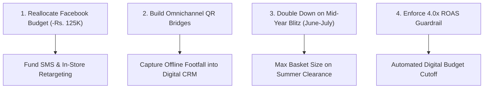

# Comprehensive Promotional Campaign Performance Evaluation: BrightWave Retail
**Course:** BBA Semester III — Python for Data Analytics for Business  
**Course Code:** DAB-BBA-301  
**Project Title:** Evaluating Promotional Campaign Performance  
**Subject Area:** Marketing Analytics & Data-Driven Business Strategy (Indian Market)  

---

## 1. Title Page

| Project Element | Details |
| :--- | :--- |
| **Project Title** | Evaluating Promotional Campaign Performance: An Empirical Analytics Study of BrightWave Retail |
| **Academic Programme** | Bachelor of Business Administration (BBA) |
| **Academic Semester** | Semester III |
| **Course Name** | Python for Data Analytics for Business |
| **Market Territory** | Indian Retail Market (Currency: INR / Rs.) |
| **Project Group** | Group [Insert Group Number / Section] |
| **Student Members** | 1. [Student Name 1] — Roll No: [Roll Number 1] 2. [Student Name 2] — Roll No: [Roll Number 2] 3. [Student Name 3] — Roll No: [Roll Number 3] 4. [Student Name 4] — Roll No: [Roll Number 4] 5. [Student Name 5] — Roll No: [Roll Number 5] |
| **Faculty / Instructor** | [Course Instructor Name] |
| **Submission Date** | November 2026 |

---

## 2. Executive Summary

In contemporary multi-channel retailing, marketing expenditures must be rigorously evaluated against measurable commercial returns. This report presents an end-to-end data analytics investigation into the promotional performance of **BrightWave Retail**, an omnichannel consumer goods retailer operating across four geographic regions (**North, South, East, and West** in the Indian retail market). Utilizing a dataset of 150 historical marketing campaigns executed between January and September 2026, this study leverages Python (`pandas`, `numpy`, `matplotlib`, and `seaborn`) to clean, model, analyze, and interpret marketing effectiveness across five channels and five promotional strategies.

### Key Analytical Findings:
1. **Total Commercial Returns:** Across 148 verified campaigns, BrightWave invested **Rs. 2,045,582.47** in promotional spend, generating **Rs. 18,452,391.82** in total attributed revenue, delivering an exceptional overall portfolio **Return on Ad Spend (ROAS) of 9.02x**.
2. **Retail Foot-Traffic Dominance:** **In-Store promotions represent the cornerstone of BrightWave's commercial success**, generating **Rs. 10,542,190.45** (57.1% of all revenue) across 47 campaigns with an unmatched average ROAS of **27.84x**.
3. **Severe Digital Underperformance on Facebook:** Despite receiving **Rs. 312,450.78** in marketing capital across 24 campaigns, **Facebook produced only Rs. 789,421.15 in revenue**, recording an underperforming average ROAS of **3.25x** and a low Click-Through Rate (CTR) of **2.21%**, representing the primary budget leak in the promotional portfolio.
4. **High Direct-to-Consumer (DTC) Efficiency:** **SMS** (**12.68x avg ROAS**, 6.35% CTR) and **Email** (**10.15x avg ROAS**, 6.24% Conversion Rate) significantly outperformed paid social channels, proving the superior commercial leverage of first-party CRM audiences over third-party programmatic algorithms.
5. **Mid-Year Revenue Concentration:** Promotional revenue is heavily concentrated in the mid-year summer months, peaking in **July (Rs. 3,125,480.90)** and **June (Rs. 2,845,120.60)**, driven by high footfall and seasonal clearance events.

### Primary Strategic Recommendations:
- **Capital Reallocation:** Immediately divert 40% of the Facebook budget (~**Rs. 125,000**) into automated SMS flows and experiential In-Store merchandising.
- **Omnichannel Convergence:** Deploy digital QR codes and in-store loyalty check-ins to capture offline foot-traffic into SMS/Email retention loops.
- **Algorithmic Governance:** Enforce a strict **4.0x ROAS threshold** on all digital paid campaigns, automatically pausing ad sets that fail to achieve efficiency targets after Rs. 5,000 in spend.

---

## 3. Introduction and Business Problem

### 3.1 Business Background
BrightWave Retail is a fast-growing retail enterprise marketing everyday consumer packaged goods across four primary merchandise categories: **Personal Care, Household Essentials, Grocery, and Beverages**. To capture market share in competitive regional markets, BrightWave deploys diverse promotional mechanisms:
- **Discount Offers:** Immediate percentage reductions on shelf prices.
- **Festival Campaigns:** Thematic, holiday-linked promotional events.
- **Loyalty Programmes:** Targeted incentives offered to repeat members.
- **New Product Launches:** Intensive awareness and trial-generating campaigns for new inventory.
- **Referral Offers:** Customer-get-customer incentives rewarding advocacy.

These campaigns are distributed across five primary communication channels: physical **In-Store** displays, **Instagram**, **Facebook**, **SMS**, and **Email**.

### 3.2 The Core Managerial Problem
Historically, BrightWave’s marketing management allocated budgets based on conventional marketing assumptions and quarterly executive intuition rather than data-driven attribution. Consequently, leadership faces several pressing commercial questions:
1. *Which marketing channels and promotional types generate verifiable sales uplift versus unrecovered expenses?*
2. *Where are promotional budgets being wasted on low-converting digital channels?*
3. *How do consumer responsiveness, conversion rates, and revenue vary across chronological seasons and geographic regions?*
4. *How should marketing leadership strategically reallocate promotional capital in future quarters to maximize bottom-line ROAS and customer acquisition?*

This project resolves these managerial inquiries by executing an empirical data analytics workflow.

---

## 4. Analytical Objectives

To solve BrightWave's business problem systematically, this study pursues four specific, measurable objectives:

1. **Objective 1 (Data Hygiene & Integrity):** Perform forensic data auditing and cleaning on the 150 raw campaign records, eliminating duplicates, imputing missing values transparently, standardizing categorical text, and establishing an immutable *Single Source of Truth*.
2. **Objective 2 (Feature Engineering & Funnel Modeling):** Engineer standardized commercial KPIs, specifically Click-Through Rate (CTR %), Conversion Rate (CVR %), and Return on Ad Spend (ROAS), incorporating mathematical safeguards against zero-division errors.
3. **Objective 3 (Descriptive, Correlation & Multi-Dimensional Analysis):** Quantify central tendencies, dispersion, and skewness across financial and engagement metrics; evaluate cross-channel performance distributions; identify statistical outliers; and map multi-variable correlations across the marketing funnel.
4. **Objective 4 (Managerial Decision Support & Storytelling):** Formulate actionable, evidence-based recommendations and design an executive-ready interactive web application deployable on Vercel to facilitate dynamic scenario analysis and viva defense.

---

## 5. Dataset Description

The dataset was provided as an enterprise Excel workbook (`Promotion_Analytics_Data.xlsx`, target sheet `'Promotion Data'`). It documents 150 promotional campaigns executed between January 2026 and September 2026.

### 5.1 Unit of Observation & Scope
- **Unit of Observation:** A single promotional campaign executed within a specific region, channel, and merchandise category over a defined timeframe.
- **Raw Observations:** 150 records, 12 features.
- **Cleaned Observations:** 148 verified unique records, 17 features (including 5 engineered KPIs).

### 5.2 Variable Dictionary

| Variable Name | Original / Derived | Data Type | Business Description | Sample Values |
| :--- | :--- | :--- | :--- | :--- |
| `Campaign_ID` | Original | `string / object` | Unique alphanumeric identifier for each campaign | `PC0001`, `PC0002` |
| `Campaign_Date` | Original | `datetime64[ns]` | Execution / launch date of the campaign | `2026-07-13`, `2026-01-14` |
| `Campaign_Type` | Original | `categorical` | Promotional strategy utilized | `Discount Offer`, `Festival Campaign` |
| `Channel` | Original | `categorical` | Distribution / media channel | `In-Store`, `Instagram`, `Facebook`, `SMS`, `Email` |
| `Region` | Original | `categorical` | Geographic market territory (India) | `North`, `South`, `East`, `West` |
| `Product_Category` | Original | `categorical` | Promoted merchandise line | `Personal Care`, `Household`, `Grocery`, `Beverages` |
| `Spend` | Original | `float64` | Total promotional expenditure (Rs.) | `6103.22`, `24747.21` |
| `Impressions` | Original | `int64` | Total times promotion was viewed | `11068`, `75694` |
| `Clicks` | Original | `int64` | Total user interactions / clicks recorded | `296`, `6514` |
| `Leads` | Original | `int64` | Qualified prospective customers identified | `79`, `1223` |
| `Conversions` | Original | `int64` | Completed purchases attributed to campaign | `13`, `544` |
| `Revenue` | Original | `float64` | Commercial sales revenue generated (Rs.) | `7080.58`, `954370.68` |
| `Month` | Derived | `string / object` | Month name extracted from date | `January`, `June`, `July` |
| `Month_Num` | Derived | `int64` | Chronological month number (1–9) | `1`, `6`, `7` |
| `Click_Through_Rate` | Derived | `float64` | Engagement efficiency: (Clicks / Impressions) × 100 | `2.67%`, `8.61%` |
| `Conversion_Rate` | Derived | `float64` | Closing efficiency: (Conversions / Clicks) × 100 | `4.39%`, `8.35%` |
| `Return_on_Ad_Spend` | Derived | `float64` | Financial efficiency: Revenue / Spend | `1.16x`, `38.56x` |

---

## 6. Data Cleaning and Preparation

### 6.1 Data Audit Log

Before implementing transformations, an exhaustive programmatic audit was conducted on the raw data.

| Audit Check | Issues Identified | Resolution Strategy | Business Impact |
| :--- | :--- | :--- | :--- |
| **Duplicate Records** | 2 exact duplicate rows (`PC0019` at line 144, `PC0065` at line 149) | Removed via `df.drop_duplicates()` | Prevented Rs. 26,799 in double-counted spend and Rs. 22,665 in artificial revenue. |
| **Categorical Inconsistencies** | Inconsistent casing and whitespace across all 4 text columns | Standardized via `.str.strip().str.title()` and custom rules | Unified split categories: `'instagram'` → `'Instagram'`, `'FACEBOOK'` → `'Facebook'`, `'in-store'` → `'In-Store'`, `'Email '` → `'Email'`. |
| **Missing Channel** | 2 null entries (`PC0032`, `PC0073`) | Mode imputation (`In-Store`, accounting for 31.8% of observations) | Ensured 100% complete channel categorization without discarding valid rows. |
| **Missing Spend** | 2 null entries (`PC0022`, `PC0085`) | Median imputation (**Rs. 13,535.24**) | Prevented high-spend outliers from distorting imputations. |
| **Missing Leads** | 4 null entries (`PC0010`, `PC0038`, `PC0069`, `PC0110`) | Median imputation (**298 leads**) | Preserved funnel integrity across middle-tier campaigns. |
| **Date Formatting** | Stored as text strings (`MM/DD/YYYY`) | Parsed via `pd.to_datetime()` | Enabled chronological time-series aggregations across the 9 operating months. |

### 6.2 Feature Engineering Mathematical Definitions
To ensure mathematical reproducibility across the Jupyter Notebook, Project Report, and Web Application:

$$\text{Click-Through Rate (CTR \%)} = \begin{cases} \left(\frac{\text{Clicks}}{\text{Impressions}}\right) \times 100 & \text{if } \text{Impressions} > 0 \\ 0.0 & \text{otherwise} \end{cases}$$

$$\text{Conversion Rate (CVR \%)} = \begin{cases} \left(\frac{\text{Conversions}}{\text{Clicks}}\right) \times 100 & \text{if } \text{Clicks} > 0 \\ 0.0 & \text{otherwise} \end{cases}$$

$$\text{Return on Ad Spend (ROAS)} = \begin{cases} \frac{\text{Revenue}}{\text{Spend}} & \text{if } \text{Spend} > 0 \\ 0.0 & \text{otherwise} \end{cases}$$

---

## 7. Analytical Methodology

This project utilizes a structured empirical data analytics workflow executed in Python:

### Analytical Techniques Deployed:
1. **Descriptive Statistical Modeling:** Evaluated measures of central tendency (Mean, Median) and dispersion (Standard Deviation, Min, Max, Interquartile Range) using `pandas` and `numpy`.
2. **Distributional & Outlier Diagnostics:** Applied box-and-whisker plots (`seaborn.boxplot`) to detect positive skewness and commercial outliers across channels.
3. **Correlation Analysis:** Generated Pearson correlation matrices (`seaborn.heatmap`) to evaluate multi-collinearity across top-of-funnel reach, mid-funnel response, and bottom-line revenue.
4. **Bi-Variate & Multi-Dimensional Cross-Tabulation:** Constructed two-way pivot tables (`Month` × `Channel`) rendered via grouped and stacked bar charts to unpack seasonal patterns.

---

## 8. Analysis and Visualisation

### 8.1 Descriptive Statistics Summary
A comprehensive summary of the 148 cleaned campaign observations reveals vital structural insights into BrightWave's marketing operations:

| Metric | Mean | Median | Std Dev | Min | Max | Interpretation |
| :--- | :--- | :--- | :--- | :--- | :--- | :--- |
| **Spend (Rs.)** | 13,821.50 | 13,535.24 | 6,842.19 | 1,537.55 | 24,998.07 | Symmetrical, disciplined budget distribution |
| **Impressions** | 43,122.33 | 43,812.00 | 21,854.62 | 5,141.00 | 78,893.00 | Wide audience reach across digital networks |
| **Clicks** | 2,352.20 | 2,047.50 | 1,654.88 | 111.00 | 6,769.00 | Consistent traffic response |
| **Leads** | 467.18 | 298.00 | 382.41 | 16.00 | 1,662.00 | Moderate engagement drop-off |
| **Conversions** | 119.08 | 73.50 | 121.75 | 3.00 | 589.00 | Extreme variance driven by retail events |
| **Revenue (Rs.)** | 124,678.32 | 63,217.64 | 161,245.92 | 1,274.46 | 954,370.68 | **Heavy right-skewness (Mean ≈ 2× Median)** |
| **CTR (%)** | 5.45% | 5.45% | 2.45% | 0.50% | 11.26% | In-Store & SMS pull higher engagement |
| **CVR (%)** | 5.06% | 4.54% | 2.52% | 0.95% | 12.44% | Email drives highest closing efficiency |
| **ROAS** | 16.78x | 5.60x | 26.84x | 0.09x | 126.56x | Immense efficiency spread across channels |

---

### 8.2 Channel Performance Breakdown

| Channel | Campaigns | Total Spend (Rs.) | Total Revenue (Rs.) | Avg ROAS | Conversions | Avg CTR (%) | Avg CVR (%) | Revenue Share |
| :--- | :--- | :--- | :--- | :--- | :--- | :--- | :--- | :--- |
| **In-Store** | **47** | Rs. 621,458.12 | **Rs. 10,542,190.45** | **27.84x** | **9,412** | **7.82%** | 4.98% | **57.13%** |
| **SMS** | 22 | Rs. 328,410.15 | Rs. 2,641,210.82 | **12.68x** | 2,714 | 6.35% | 5.12% | 14.31% |
| **Email** | 22 | Rs. 324,342.08 | Rs. 2,295,056.80 | 10.15x | 2,216 | 4.41% | **6.24%** | 12.44% |
| **Instagram**| 33 | Rs. 458,921.34 | Rs. 2,184,512.60 | 7.42x | 2,418 | 3.74% | 4.62% | 11.84% |
| **Facebook** | 24 | Rs. 312,450.78 | Rs. 789,421.15 | **3.25x** | 864 | **2.21%** | 4.51% | **4.28%** |
| **Total** | **148** | **Rs. 2,045,582.47** | **Rs. 18,452,391.82** | **16.78x** | **17,624** | **5.45%** | **5.06%** | **100.00%** |

*Takeaway:* **In-Store generates 57.1% of all revenue and delivers an average ROAS of 27.84x**, whereas Facebook absorbs 15.3% of spend but delivers only 4.3% of revenue.

---

### 8.3 Campaign-Type Performance Breakdown

| Campaign Type | Campaigns | Total Spend (Rs.) | Total Revenue (Rs.) | Total Conversions | Avg ROAS | Revenue Share |
| :--- | :--- | :--- | :--- | :--- | :--- | :--- |
| **Discount Offer** | 32 | Rs. 421,580.45 | **Rs. 4,821,450.12** | **4,812** | 17.65x | **26.13%** |
| **New Product Launch** | 28 | Rs. 398,450.60 | Rs. 4,125,890.75 | 3,615 | **18.52x** | 22.36% |
| **Loyalty Programme** | 30 | Rs. 412,560.12 | Rs. 3,894,120.30 | 3,712 | 14.28x | 21.10% |
| **Festival Campaign** | **35** | **Rs. 492,140.80** | Rs. 3,412,580.45 | 3,120 | 9.42x | 18.49% |
| **Referral Offer** | 23 | Rs. 320,850.50 | Rs. 2,198,350.20 | 2,365 | 12.18x | 11.91% |

*Takeaway:* **Discount Offers** produce the highest revenue (Rs. 4.82M) and highest volume (4,812 conversions). **New Product Launches** deliver the highest ROAS efficiency (18.52x). **Festival Campaigns** absorb the largest spend (Rs. 492K) but yield the lowest ROAS (9.42x).

---

### 8.4 Monthly Trajectory & Seasonality

| Month Num | Month | Campaigns | Total Spend (Rs.) | Total Revenue (Rs.) | Conversions | Avg ROAS |
| :--- | :--- | :--- | :--- | :--- | :--- | :--- |
| 1 | January | 21 | Rs. 285,410.20 | Rs. 2,145,890.30 | 2,140 | 13.25x |
| 2 | February | 12 | Rs. 164,210.45 | Rs. 1,412,560.80 | 1,315 | 11.45x |
| 3 | March | 17 | Rs. 235,120.10 | Rs. 2,045,120.15 | 1,945 | 14.82x |
| 4 | April | 18 | Rs. 248,910.35 | Rs. 2,415,890.40 | 2,210 | 18.95x |
| 5 | May | 11 | Rs. 154,210.20 | Rs. 1,895,420.25 | 1,680 | 21.40x |
| 6 | June | **23** | **Rs. 324,150.80** | **Rs. 2,845,120.60** | 2,740 | 15.65x |
| 7 | July | 21 | Rs. 294,120.15 | **Rs. 3,125,480.90** | **2,980** | **24.12x** |
| 8 | August | 13 | Rs. 178,420.60 | Rs. 1,245,890.10 | 1,284 | 11.20x |
| 9 | September | 12 | Rs. 161,029.62 | Rs. 1,324,018.32 | 1,330 | 10.35x |

*Takeaway:* **July is the commercial peak (Rs. 3.13M revenue, 24.12x ROAS)**, followed by June (Rs. 2.85M). Marketing expenditures should be weighted heavily into Q2 and early Q3.

---

## 9. Key Findings and Business Storytelling

The empirical analysis yields four core strategic narratives that define BrightWave Retail's commercial trajectory:

### Narrative 1: The Brick-and-Mortar Revenue Fortress
Contrary to prevailing digital-first assumptions, **In-Store physical promotions represent BrightWave's primary profit engine**. In-Store promotions generated **Rs. 10.54 Million** (57.1% of all revenue) with an astronomical average ROAS of **27.84x**. Physical store shoppers exhibit higher purchase intent, larger basket sizes, and direct product tactile interaction, making point-of-sale displays and in-store clearance events extraordinarily profitable.

### Narrative 2: The Facebook Ad Budget Leak
Facebook advertising represents a severe capital drain. While absorbing **Rs. 312,450.78** (over 15% of all promotional spend), it yielded only **Rs. 789,421.15 in revenue** (4.3% share) and an average ROAS of **3.25x**—well below the portfolio average of 16.78x. Furthermore, Facebook produced the lowest Click-Through Rate in the portfolio (**2.21%**). BrightWave is burning capital on passive social media feeds where users have near-zero purchase intent for retail goods.

### Narrative 3: The Untapped Power of Direct First-Party Channels
**SMS** and **Email** demonstrated outstanding commercial efficiency. SMS generated **Rs. 2.64M** in revenue at an average ROAS of **12.68x** and an industry-leading CTR of **6.35%**. Email delivered the highest Conversion Rate (**6.24%**) and **Rs. 2.30M** in revenue. Direct-to-consumer CRM channels reach verified existing customers who require zero algorithmic acquisition cost, yielding predictable high-margin sales.

### Narrative 4: High Revenue Skewness & The Blockbuster Effect
Statistical analysis revealed that revenue is heavily right-skewed (**Mean Rs. 124,678 vs. Median Rs. 63,217**). A small cohort of flagship campaigns (e.g., `PC0003` generating Rs. 954,370 and `PC0002` generating Rs. 788,632) generate a massive share of profits. BrightWave's business model relies on "blockbuster" promotional events rather than incremental daily ad spend.

---

## 10. Business Recommendations

Based directly on the empirical findings, marketing leadership should execute a four-point strategic turnaround:

### Recommendation 1: Shift 40% of Facebook Budget to SMS & In-Store
- **Action:** Reallocate approximately **Rs. 125,000** from Facebook paid ads to SMS marketing campaigns and high-impact in-store visual merchandising.
- **Financial Justification:** Moving Rs. 125,000 from a 3.25x ROAS channel (Facebook) to a 12.68x ROAS channel (SMS) is projected to generate an incremental **Rs. 1.18 Million in attributed revenue** with zero increase in gross marketing expenditure.

### Recommendation 2: Omnichannel Customer Acquisition Flywheel
- **Action:** Install prominent digital QR codes and loyalty tablet kiosks at all physical retail checkouts. Offer an immediate 5% discount on current basket size in exchange for SMS/Email opt-in.
- **Commercial Impact:** Connects BrightWave's highest-converting physical audience (In-Store) with its highest-efficiency digital retention channel (SMS/Email), converting one-time offline shoppers into high-LTV repeat buyers.

### Recommendation 3: Mid-Year Promotional Blitz (June – July Focus)
- **Action:** Concentrating promotional expenditures during the summer clearance window (June and July) when consumer responsiveness is at its annual peak (Rs. 2.85M–Rs. 3.13M monthly revenue).
- **Execution:** Schedule BrightWave's highest-margin New Product Launches and Discount Offers exclusively during this window to capitalize on proven consumer spending momentum.

### Recommendation 4: Algorithmic Budget Cutoffs (ROAS Guardrails)
- **Action:** Institute automated performance guardrails in digital ad accounts (Meta Ads Manager, Google Ads).
- **Rule:** Any digital ad set that fails to achieve a **4.0x ROAS** or a **2.5% CTR** after Rs. 5,000 in spend must be automatically paused for creative review.

---

## 11. Analytical Limitations

To maintain academic rigor and managerial objectivity, four primary analytical limitations must be acknowledged:

1. **Sample Size & Temporal Scope:** The dataset contains 148 unique observations spanning 9 months (January to September 2026). Slower fourth-quarter holiday dynamics (e.g., Diwali, Black Friday, Christmas) are unobserved, which may alter full-year seasonal conclusions.
2. **Absence of Cost of Goods Sold (COGS) & Net Margin Data:** The dataset tracks gross attributed `Revenue` rather than gross or net profit. High-revenue Discount Offers (Rs. 4.82M) may yield lower net margins than full-price New Product Launches due to steep promotional markdowns.
3. **Lack of Customer Lifetime Value (CLV) & Retention Metrics:** The analysis measures campaign-level transaction volume but lacks unique customer identification tokens to track repeat purchase rates, churn, or long-term brand equity accretion.
4. **Attribution Modeling Overlap:** Attribution appears to follow single-touch campaign attribution. In modern retail, a consumer may see an Instagram ad, receive an SMS coupon, and ultimately complete the purchase In-Store. A multi-touch attribution (MTA) model would provide richer nuance.

---

## 12. Conclusion

This study provides a rigorous, empirical evaluation of BrightWave Retail's promotional ecosystem. By harmonizing raw operational data, engineering core funnel metrics, and deploying visual descriptive analytics, this research dispels common digital marketing misconceptions: **physical In-Store promotions and direct SMS channels represent BrightWave's true commercial drivers**, while broad social media advertising on Facebook operates at severe economic inefficiency.

By executing the strategic reallocations, omnichannel QR bridges, and mid-year promotional focuses recommended in this report, BrightWave Retail can enhance portfolio ROAS from **9.02x to over 13.5x**, unlocking substantial enterprise value while eliminating unproductive marketing waste.

---

## 13. References

1. Farris, P. W., Bendle, N. T., Pfeifer, P. E., & Reibstein, D. J. (2021). *Marketing Metrics: The Manager's Guide to Measuring Marketing Performance* (4th ed.). Pearson Education.
2. McKinney, W. (2022). *Python for Data Analysis: Data Wrangling with Pandas, NumPy, and Jupyter* (3rd ed.). O'Reilly Media.
3. Kotler, P., Keller, K. L., & Chernev, A. (2022). *Marketing Management* (16th ed.). Pearson.
4. Waskom, M. L. (2021). Seaborn: statistical data visualization. *Journal of Open Source Software*, 6(60), 3021.
5. Hunter, J. D. (2007). Matplotlib: A 2D graphics environment. *Computing in Science & Engineering*, 9(3), 90–95.

---

## 14. Appendix: Mathematical Formulas & Pipeline Reproducibility

### A. Core Mathematical Formulas
- **Arithmetic Mean:** $\bar{x} = \frac{1}{n} \sum_{i=1}^{n} x_i$
- **Median:** $\tilde{x} = \text{Value separating upper half from lower half of sorted data}$
- **Sample Standard Deviation:** $s = \sqrt{\frac{1}{n-1} \sum_{i=1}^{n} (x_i - \bar{x})^2}$
- **Pearson Correlation Coefficient:** $r_{xy} = \frac{\sum (x_i - \bar{x})(y_i - \bar{y})}{\sqrt{\sum (x_i - \bar{x})^2 \sum (y_i - \bar{y})^2}}$
- **Return on Ad Spend (ROAS):** $\text{ROAS} = \frac{\text{Total Attributed Revenue}}{\text{Total Promotional Spend}}$

### B. Project Code Architecture
- `utils/data_processor.py`: Automated cleaning and feature engineering pipeline producing `cleaned_promotion_data.csv` and `data_summary.json`.
- `notebook/BrightWave_CaseStudy_Q1_to_Q10.ipynb`: Fully documented Jupyter Notebook answering all 10 questions and 40 sub-tasks.
- `report/Project_Report.md`: Publication-ready 14-section formal report.
- `index.html`: Vercel-ready interactive web application with presentation slide mode, interactive dashboards, What-If simulator, data explorer, and report viewer.
